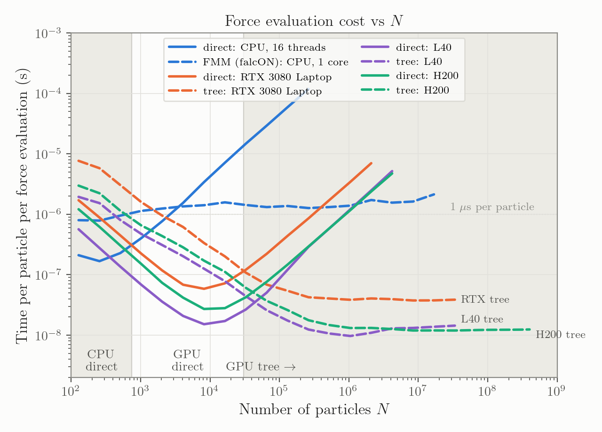

<p align="center">
  <picture>
    <source media="(prefers-color-scheme: dark)" srcset="plots/logo/nbody_streams_logo_dark.svg">
    
  </picture>
</p>

<p align="center">
  <em>GPU N-body simulations of stellar streams in Python</em>
</p>

<p align="center">
  
  <a href="#installation"></a>
  <a href="LICENSE"></a>
  <a href="https://doi.org/10.5281/zenodo.20834762"></a>
  <a href="https://doi.org/10.3847/1538-4357/ae89af"></a>
</p>

---

**nbody_streams** is a GPU-accelerated Python toolkit for simulating how
satellite galaxies and star clusters are torn apart by their hosts. It runs
N-body simulations on the GPU or CPU through one function, `run_simulation`,
generates streams quickly with particle-spray and restricted N-body methods,
and includes tools to analyse and plot the results.

Host potentials use the formats of
[Agama](https://github.com/GalacticDynamics-Oxford/Agama): pass any
`agama.Potential`, or `PotentialGPU`, the package's own GPU implementation of
Agama's potentials, which reads the same files and is faster for large
particle counts.

## Installation

Python 3.8-3.13 (3.12 recommended) on Linux or macOS. The GPU features need
an NVIDIA GPU and the CUDA compiler `nvcc` (CUDA 12+), which CuPy does not
include.

```bash
# 1. A fresh environment with the CUDA compiler
conda create -n nbody python=3.12 numpy setuptools
conda activate nbody
conda install -c conda-forge cuda-toolkit cuda-version=12   # provides nvcc
pip install cupy-cuda12x

# 2. The package, with Agama; this also compiles the GPU tree (~20 s)
git clone https://github.com/appy2806/Nbody_streams.git
cd Nbody_streams
pip install -e ".[agama]" --no-build-isolation

# 3. Check: compiles and runs one GPU force call
python -c "import numpy as np, nbody_streams as nb; nb.compute_nbody_forces_gpu(np.random.rand(1000, 3), 1.0, softening=0.01); print('GPU direct OK | GPU tree:', nb._TREE_GPU_AVAILABLE)"
```

<details>
<summary><strong>No GPU, or installing on a cluster</strong></summary>

- **No GPU:** skip the `cuda-toolkit` and CuPy lines. The same `pip install`
  works; you get the CPU backends and everything else except the GPU solvers.
- **On a cluster:** replace the conda CUDA line with `module load cuda` (or
  your cluster's equivalent), and load the same module in every job script:
  the GPU direct sum and `PotentialGPU` compile their kernels with `nvcc` when
  they first run. A login node usually has no GPU, so after installing there,
  run `nbody-build-tree` once on a GPU node to rebuild the tree for that GPU.

</details>

<details>
<summary><strong>Notes on the install commands</strong></summary>

- `--no-build-isolation` makes pip build inside your current environment,
  which is why numpy and setuptools are installed first.
- Agama is compiled from source and needs a C++ compiler (`g++`).
- For CUDA 13 use `cuda-version=13` and `cupy-cuda13x`. Either way, the CUDA
  version must not be newer than the one `nvidia-smi` reports.
- `nvcc` is used at install time to build the GPU tree, and at run time to
  compile the GPU direct-sum and `PotentialGPU` kernels.

</details>

<details>
<summary><strong>What each feature needs</strong></summary>

| Feature | Needs |
|---|---|
| CPU direct sum | nothing extra |
| CPU tree (falcON FMM) | `pip install -e ".[falcon]" --no-build-isolation` |
| GPU direct sum, `PotentialGPU` | CuPy, and `nvcc` when the code runs |
| GPU tree | CuPy, and `nvcc` when you run `pip install` |
| Host potentials, `fast_sims`, `agama_helper` | [Agama](https://github.com/GalacticDynamics-Oxford/Agama) (the `[agama]` extra) |
| Mollweide sky maps | `pip install -e ".[healpy]"` |

</details>

<details>
<summary><strong>If the GPU tree did not build</strong></summary>

Without `nvcc` the install still succeeds and prints a warning (visible with
`pip install -v`); everything except the GPU tree works. Once `nvcc` is
available, build the library in place with:

```bash
nbody-build-tree
```

Run it again after changing GPU or CUDA version, or after pulling changes to
the `.cu` sources. Without a visible GPU the build targets `sm_80` (Ampere,
e.g. an A100), which newer GPUs run less efficiently. Set
`NBODY_STREAMS_BUILD_TREE=1` to make `pip install` fail instead of warning,
or `0` to skip the build.

The CuPy direct-sum kernels also run on AMD GPUs through ROCm; the tree code is
NVIDIA-only (portable with `hipify`).

</details>

Units throughout: kpc, km/s and M<sub>sun</sub>; time is in kpc/(km/s)
(~0.978 Gyr), and `G = 4.300917e-6`.

## Quick start

A 2&times;10<sup>4</sup> M<sub>sun</sub> globular cluster on an orbit in a
Milky Way host, integrated for ~3 Gyr with the GPU tree (about 5 minutes on a
laptop RTX 3080):

```python
from importlib.resources import files

import agama
from nbody_streams import Species, make_plummer_sphere, run_simulation
from nbody_streams.viz import plot_stream_sky

agama.setUnits(mass=1, length=1, velocity=1)        # Msun, kpc, km/s
host = agama.Potential(str(files("nbody_streams") / "data/potentials/McMillan17.ini"))

# 10 pc Plummer cluster, shifted to its starting point on the orbit
N = 20_000
xv, _ = make_plummer_sphere(N, M_total=2e4, a=0.01, seed=1)
xv += [-10.9, -3.4, -22.2, 70.4, 188.6, 95.8]       # x, y, z [kpc], vx, vy, vz [km/s]

result = run_simulation(
    xv, [Species.star(N=N, mass=2e4 / N, softening=4e-4)],  # softening 0.4 pc
    time_start=0.0, time_end=3.0, dt=1e-4,          # 30,000 steps of ~0.1 Myr
    architecture="gpu", method="tree",              # "direct" is as fast below ~3e4 particles
    external_potential=host,
    output_dir="./output/gc_stream", snapshots=50,
    overwrite=True,                                 # replace snapshots from a previous run
)
stream = result["star"]                 # (N, 6) at time_end: the bound remnant plus its tails
fig, axes = plot_stream_sky(stream)     # RA/Dec, v_los, (phi1, phi2) and XYZ panels
```

Without a GPU, use `architecture="cpu"`. At this N it takes well over an
hour rather than minutes, and `method="tree"` on the CPU needs the `[falcon]`
extra. Each run
writes its snapshots to one HDF5 file:

```python
from nbody_streams import ParticleReader

snap = ParticleReader("./output/gc_stream/snapshot.h5").read_snapshot(49)  # last of 50
snap.time, snap.species["star"]["posvel"]
```

For thousands of streams, the particle-spray method skips the cluster's
self-gravity: it releases stars near the cluster's tidal radius and
integrates them as test particles in the host plus a cluster potential, in a
few seconds. Note that it reads the phase-space point as the cluster's
**present-day** position and first rewinds the orbit by `time_total`, so this
stream ends where the cluster is today, not where the N-body run above ends:

```python
from nbody_streams.fast_sims import create_particle_spray_stream

spray = create_particle_spray_stream(
    pot_host=host, initmass=2e4, scaleradius=0.01,
    sat_cen_present=[-10.9, -3.4, -22.2, 70.4, 188.6, 95.8],
    num_particles=10_000,
    time_total=3.0,        # how far back to start, kpc/(km/s) ~ 0.98 Gyr
    time_end=13.78,        # the present-day time (matters only for time-dependent hosts)
)
spray["part_xv"]           # (10000, 6) stream at time_end
```

The restricted N-body method (`run_restricted_nbody`) sits in between: it
also uses test particles, but refits the cluster's potential from the
particles that are still bound as it goes, so it tracks the cluster's mass
loss.

### Example notebooks

| Notebook | Shows |
|---|---|
| [`run_simulation`](examples/run_simulation.ipynb) | Species, single- and multi-species runs, reading snapshots |
| [`stream_Nbody`](examples/stream_Nbody.ipynb) | A globular cluster (the AAU progenitor) disrupting in a Milky Way + LMC host: mass-loss rates, stripping times, stream morphology |
| [`MW_LMC_evolv`](examples/MW_LMC_evolv.ipynb) | A moving LMC and the Milky Way's reflex motion as time-dependent potentials |
| [`coef_time_axis`](examples/coef_time_axis.ipynb) | BFE coefficient time series and evolving cosmological hosts |
| [`dynamical_friction_tutorial`](examples/dynamical_friction_tutorial.ipynb) | Chandrasekhar dynamical friction |
| [`pretty_density_methods`](examples/pretty_density_methods.ipynb) | SPH, smoothed and histogram density maps |
| [`MW_gpu_tree_stability`](examples/MW_gpu_tree_stability.ipynb), [`plummer_stability_gpu_tree`](examples/plummer_stability_gpu_tree.ipynb) | GPU-tree stability and energy conservation |

## Documentation

New to the package? Work through the `run_simulation` notebook, then
`stream_Nbody`. In the code, `run_simulation` (`sim.py`) is the entry point:
it checks the inputs and hands off to the direct-sum integrators (`run.py`,
with force kernels in `fields.py`) or the GPU tree (`tree_gpu/`). Host
potentials come from `agama_helper/`, the fast stream generators live in
`fast_sims/`, and `coords/`, `utils/` and `viz/` work on the output.

Module reference lives in [`docs/`](docs/index.md):

| Module | Purpose | Reference |
|---|---|---|
| Quick start | Installation, units, first runs, choosing a backend | [quickstart.md](docs/quickstart.md) |
| `nbody_streams` | `run_simulation`, `Species`, `make_plummer_sphere` | [main.md](docs/main.md) |
| `fields` | Force and potential kernels (GPU and CPU) | [fields.md](docs/fields.md) |
| `run` | Low-level KDK leapfrog integrators | [run.md](docs/run.md) |
| `tree_gpu` | GPU Barnes-Hut tree: `tree_gravity_gpu`, `TreeGPU`, `run_nbody_gpu_tree` | [tree_gpu.md](docs/tree_gpu.md) |
| `nbody_io` | HDF5 snapshots, restarts, `ParticleReader` | [io.md](docs/io.md) |
| `fast_sims` | Particle spray and restricted N-body streams | [fast_sims.md](docs/fast_sims.md) |
| `agama_helper` | Fit, store and load Agama BFE potentials; `PotentialGPU`; evolving and FIRE hosts | [agama_helper.md](docs/agama_helper.md) |
| `coords` | Coordinate transforms, stream frames and observables | [coords.md](docs/coords.md) |
| `utils` | Profiles, shapes, centre finding, unbinding, cosmology | [utils.md](docs/utils.md) |
| `viz` | Density maps, SPH renderer, sky and evolution plots | [viz.md](docs/viz.md) |
| Dynamical friction | Theory, `df_*` options, caveats | [dynamical_friction.md](docs/dynamical_friction.md) |

Changes between versions are listed in [CHANGELOG.md](CHANGELOG.md).

<details>
<summary><strong>Under the hood</strong></summary>

Python handles orchestration only (validation, dispatch, I/O); every force
evaluation runs in compiled, parallel code.

| Path | Implementation | Details |
|---|---|---|
| GPU direct | CUDA kernels compiled at runtime (CuPy + nvcc) | `float4` loads, optional Kahan summation, split source loop at small N |
| GPU tree | C++/CUDA library (`libtreeGPU.so`) via ctypes | Barnes-Hut with quadrupoles, per-particle softening, float32 tree on recentred positions |
| CPU direct | Numba `@njit(parallel=True)` | JIT-compiled and cached |
| CPU tree | falcON via pyfalcon | O(N) fast multipole method |
| Integration | KDK leapfrog | float64 positions and velocities on every backend |
| Hosts | Agama (CPU) or `PotentialGPU` | Added to the self-gravity each step |

</details>

## Performance

<p align="center">
  
</p>

The GPU tree costs a constant ~1.2&times;10<sup>-8</sup> s per particle on
an H200 or L40 from ~5&times;10<sup>5</sup> particles on, up to
4.8&times;10<sup>8</sup> particles (6.0 s per force call). At 10<sup>6</sup>
particles on an H200 it is ~90&times; faster than the GPU direct sum. The shaded bands
mark the fastest solver on the laptop:

| Particle count | Fastest | Notes |
|---|---|---|
| N < ~750 | CPU direct (Numba) | No kernel-launch overhead |
| ~750 to ~3e4 | GPU direct | Exact pairwise forces; `float32_kahan` matches float64 to ~1e-6 |
| N > ~3e4 | GPU tree | theta = 0.6: median force error ~1e-4, 99th percentile ~4e-4 |
| No GPU, large N | CPU tree (falcON) | ~1.5e-6 s per particle on one core |

<details>
<summary><strong>Timing table and largest N per GPU</strong></summary>

Time per force evaluation (all particles), Plummer sphere, eps = 0.01 a,
theta = 0.6, minimum over repeated calls. RTX 3080 Laptop GPU (16 GB) +
i9-11980HK (16 threads); NVIDIA L40 (48 GB, shared, 26 GB free); NVIDIA H200
(141 GB). GPU direct uses `float32_kahan`.

| N | CPU direct (16 thr) | FMM falcON (1 core) | GPU direct RTX / L40 / H200 | GPU tree RTX / L40 / H200 |
|---|---|---|---|---|
| 8,192 | 27.9 ms | 11.6 ms | 0.48 / 0.12 / 0.22 ms | 2.75 / 1.03 / 1.40 ms |
| 131,072 | 7.78 s | 180 ms | 57.7 / 15.9 / 19.3 ms | 7.11 / 2.28 / 3.40 ms |
| 1,048,576 | - | 1.46 s | 3.60 / 1.27 / 1.23 s | 40.4 / 10.2 / 13.8 ms |
| 8,388,608 | - | 13.6 s | - | 315 / 110 / 100 ms |
| 33,554,432 | - | - | - | 1.30 / 0.48 / 0.40 s |
| 100,000,000 | - | - | - | - / - / 1.22 s |
| 400,000,000 | - | - | - | - / - / 4.97 s |

Below ~4e6 particles the L40 tree is faster than the H200's (higher clocks and
FP32 rate); above 1e7 the H200 is ahead. At N = 10,240 on the RTX 3080 the GPU
direct sum takes 0.41 ms (`float32`), 0.56 ms (`float32_kahan`) and 13.6 ms
(`float64`; consumer GPUs run float64 at 1/64 rate).

**Largest N.** `TreeGPU` and `run_nbody_gpu_tree` refuse an N that would not
fit in 80% of the free GPU memory, with a `ValueError` instead of an
out-of-memory crash; raise the fraction on a dedicated GPU with
`nbody_streams.tree_gpu.set_memory_fraction(0.95)`. A one-off call needs
~215 B per particle on top of its float64 positions, `run_nbody_gpu_tree`
~375 B per particle in all (H200: 1.24 s per step at 1e8, 2.47 s at 2e8).

| GPU | `tree_gravity_gpu` (0.8 / 0.95) | Measured |
|---|---|---|
| RTX 3080 Laptop, 16 GB | ~42M / ~50M | 4e7: 1.53 s per call, 10.6 GB |
| H200, 141 GB | ~421M / ~494M | 4.8e8 at 0.95: 6.0 s per call, 108.6 GB |

The index limit is 2^29 = 537M particles. Benchmarks: `benchmarks/`
(`timing_sweep.py`, `max_n.py`, `plot_timings.py`).

</details>

<details>
<summary><strong>Force accuracy, and clusters far from the origin</strong></summary>

**How accurate are the forces?** Relative force error against an exact
float64 direct sum (Hernquist sphere, N = 1e5):

| Solver | Typical (median) | Worst 1% (99th percentile) |
|---|---|---|
| GPU direct (default `float32_kahan`) | 5e-8 | 9e-7 |
| GPU tree, theta = 0.4 | 3e-5 | 1.5e-4 |
| GPU tree, theta = 0.6 (default) | 1e-4 | 4e-4 |
| GPU tree, theta = 0.8 | 3e-4 | 1.5e-3 |

Energy is conserved to dE/E of 2e-6 or better over 1000-2000 steps for a 1-pc
cluster with either solver.

**Why distance from the origin matters, and what the code does about it.**
GPU forces are computed in float32, which keeps about 7 significant digits of
each coordinate. For a cluster 40 kpc from the host centre that means every
position is rounded to ~0.004 pc, which is a few percent of the spacing
between neighbouring stars in a 1-pc cluster, and the forces between them
come out wrong.

nbody_streams avoids this automatically. Positions are stored in float64, and
before each float32 force call they are shifted (in float64) so the origin
sits at the cluster's centre. Gravity between particles does not depend on
where the origin is, so the forces are the same, but the rounding is now
relative to the cluster's size instead of its distance from the host.

The same 1-pc cluster at 40 kpc, worst-1% force error:

| Solver | Without recentring | With recentring (automatic) |
|---|---|---|
| GPU direct | 1.6e-2 | 9e-7 |
| GPU tree, theta = 0.6 | 1.6e-2 | 4e-4 (as accurate as at the origin) |

This happens inside `run_simulation` and every integrator. If you call the
low-level force functions yourself, pass float64 positions: float32 input is
used as given, without recentring.

</details>

<details>
<summary><strong>Caveats: hosts as fixed fields and dynamical friction</strong></summary>

With `external_potential`, the host is a **smooth background field**: there
is no back-reaction on the host and no scattering by its particles. This is
an excellent approximation for low-mass satellites but not for LMC-class
objects. Chandrasekhar dynamical friction on the satellite's centre of mass
is available with `run_simulation(..., dynamical_friction=True, df_M_sat=...)`;
see [dynamical_friction.md](docs/dynamical_friction.md).

Rough inspiral times at 50 kpc in a Milky Way halo:

| M<sub>sat</sub> (M<sub>sun</sub>) | Example | t<sub>DF</sub> | Ignore DF? |
|---|---|---|---|
| < 1e8 | Globular cluster | > 2000 Gyr | Yes |
| 1e8 - 1e9 | Ultra-faint dwarf | 200 - 2000 Gyr | Yes |
| 1e9 - 1e10 | SMC-class | 20 - 200 Gyr | Marginal over few-Gyr runs |
| > 1e10 | LMC-class | < 20 Gyr | No |

`run_simulation` emits a `PerformanceWarning` when the satellite mass exceeds
1e10 M<sub>sun</sub> with an external potential and no dynamical friction.

</details>

## How to cite

If you use nbody_streams in published work, please cite the paper and the
software. The software DOI below always points to the latest release archived
on Zenodo; the Zenodo page also lists a DOI for each version, if you want to
cite the exact one you used.

```bibtex
@ARTICLE{Arora2026,
       author = {{Arora}, Arpit and {Ferguson}, Peter S. and {Nibauer}, Jacob and {Shipp}, Nora and {Reddy}, Videep and {Vasiliev}, Eugene and {Kohm}, Jack and {Marin}, Laurella C. and {Price-Whelan}, Adrian M. and {Erkal}, Denis and {Pearson}, Sarah and {Wetzel}, Andrew and {Bailin}, Jeremy and {Feldmann}, Robert},
        title = "{No Stream Left Unscathed: The Imprint of a Host Galaxy}",
      journal = {The Astrophysical Journal},
     keywords = {Stellar streams, Astrophysics of Galaxies},
         year = 2026,
        month = sep,
       volume = {1008},
       number = {1},
          eid = {91},
        pages = {91},
          doi = {10.3847/1538-4357/ae89af},
archivePrefix = {arXiv},
       eprint = {2605.16200},
 primaryClass = {astro-ph.GA},
       adsurl = {https://ui.adsabs.harvard.edu/abs/2026ApJ..1008...91A},
      adsnote = {Provided by the SAO/NASA Astrophysics Data System}
}

@software{nbody_streams,
  author       = {Arpit Arora},
  title        = {appy2806/Nbody\_streams},
  year         = 2026,
  publisher    = {Zenodo},
  doi          = {10.5281/zenodo.20834762},
  url          = {https://doi.org/10.5281/zenodo.20834762},
}
```

## License

MIT; see [LICENSE](LICENSE).
